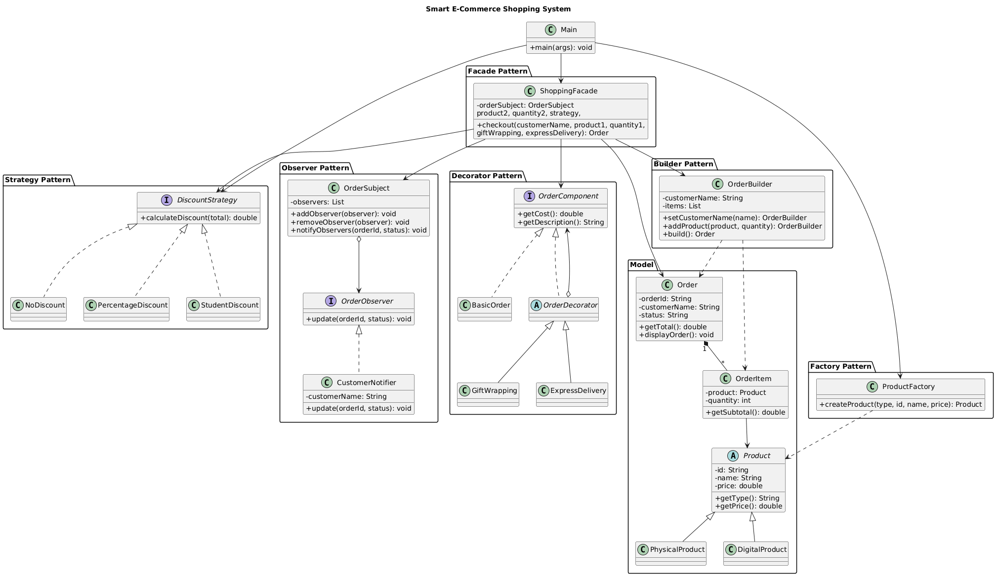

# 🛒 Smart E-Commerce Shopping System

### A Java-Based Online Shopping and Order Management System


---

## 📌 Project Overview

**Smart E-Commerce Shopping System** is a Java-based application that simulates the core functionality of an online shopping platform.

The application allows customers to browse available products, create orders, apply discount strategies, add additional services, and receive notifications about order status changes.

The main goal of this project is to demonstrate the practical implementation and integration of six software design patterns in one application.

The system is developed using Java 17 and Object-Oriented Programming principles.

---

## 🎯 Project Objectives

* Implement six different software design patterns.
* Demonstrate interaction between multiple design patterns.
* Create a modular and maintainable application architecture.
* Implement product and order management functionality.
* Provide flexible discount calculation.
* Support optional order services.
* Demonstrate the use of OOP principles in a practical application.

---

## 🧩 Design Patterns Implemented

This project implements six design patterns:

| Design Pattern | Purpose                                      | Implementation     |
| -------------- | -------------------------------------------- | ------------------ |
| Factory        | Creates different product types              | `ProductFactory`   |
| Builder        | Constructs orders step by step               | `OrderBuilder`     |
| Strategy       | Provides interchangeable discount algorithms | `DiscountStrategy` |
| Observer       | Notifies customers about order updates       | `OrderSubject`     |
| Decorator      | Adds optional services to orders             | `OrderDecorator`   |
| Facade         | Simplifies the checkout process              | `ShoppingFacade`   |

### 1. Factory Pattern

Used to create different types of products, such as physical and digital products, without directly instantiating their concrete classes throughout the application.

### 2. Builder Pattern

Used to construct orders step by step by specifying customer information, products, and quantities.

### 3. Strategy Pattern

Used to implement interchangeable discount calculation algorithms.

Available strategies:

* No Discount
* Percentage Discount
* Student Discount (15%)

### 4. Observer Pattern

Used to notify customers when their order status changes.

The notification system allows observers to subscribe to order updates.

### 5. Decorator Pattern

Used to dynamically add additional services to an order without modifying its original implementation.

Available decorators:

* Gift Wrapping (+$5)
* Express Delivery (+$10)

### 6. Facade Pattern

Provides a simplified interface for the checkout process by coordinating order creation, discount calculation, additional services, and customer notifications.

---

## 🏗️ Project Structure

```text
smart-ecommerce-design-patterns/
│
├── src/
│   └── main/
│       └── java/
│           └── com/
│               └── aitu/
│                   └── ecommerce/
│                       │
│                       ├── builder/
│                       │   └── OrderBuilder.java
│                       │
│                       ├── decorator/
│                       │   ├── BasicOrder.java
│                       │   ├── ExpressDelivery.java
│                       │   ├── GiftWrapping.java
│                       │   ├── OrderComponent.java
│                       │   └── OrderDecorator.java
│                       │
│                       ├── factory/
│                       │   └── ProductFactory.java
│                       │
│                       ├── facade/
│                       │   └── ShoppingFacade.java
│                       │
│                       ├── model/
│                       │   ├── Product.java
│                       │   ├── PhysicalProduct.java
│                       │   ├── DigitalProduct.java
│                       │   ├── Order.java
│                       │   └── OrderItem.java
│                       │
│                       ├── observer/
│                       │   ├── OrderObserver.java
│                       │   ├── OrderSubject.java
│                       │   └── CustomerNotifier.java
│                       │
│                       ├── strategy/
│                       │   ├── DiscountStrategy.java
│                       │   ├── NoDiscount.java
│                       │   ├── PercentageDiscount.java
│                       │   └── StudentDiscount.java
│                       │
│                       └── Main.java
│
├── README.md
└── .gitignore
```

---

## 📊 UML Class Diagram

The following section is reserved for the UML Class Diagram of the Smart E-Commerce Shopping System.

The diagram illustrates:

* Main classes and interfaces.
* Relationships between application components.
* Implementation of all six design patterns.
* Dependencies between different packages.

### UML Class Diagram



*Figure 1. UML Class Diagram of the Smart E-Commerce Shopping System.*

---

## ⚙️ Technologies Used

| Technology                  | Purpose                   |
| --------------------------- | ------------------------- |
| Java 17                     | Main programming language |
| IntelliJ IDEA               | Development environment   |
| Object-Oriented Programming | Application architecture  |
| PlantUML                    | UML diagram creation      |
| Git                         | Version control           |
| GitHub                      | Source code repository    |

---


## 💻 Application Features

The application provides the following functionality:

1. **Product Creation** — creates physical and digital products.
2. **Product Selection** — allows customers to select products.
3. **Order Creation** — builds customer orders with selected products and quantities.
4. **Discount Selection** — allows customers to choose a discount strategy.
5. **Additional Services** — supports gift wrapping and express delivery.
6. **Price Calculation** — calculates subtotal, discounts, additional costs, and final price.
7. **Order Confirmation** — updates the order status.
8. **Customer Notifications** — notifies customers about order status changes.

---

## 🧪 Example Application Scenario

Example of a customer placing an order:

**Customer:** Muratbek

**Selected Products:**

* Laptop — $1000
* Headphones × 2 — $400

**Discount:**

* Student Discount — 15%

**Additional Services:**

* Gift Wrapping — $5
* Express Delivery — $10

### Order Calculation

| Description            |    Amount |
| ---------------------- | --------: |
| Subtotal               |     $1400 |
| Student Discount (15%) |     -$210 |
| Gift Wrapping          |       +$5 |
| Express Delivery       |      +$10 |
| **Final Price**        | **$1205** |

**Order Status:** CONFIRMED

**Notification:** Customer receives an order confirmation notification.

---

## 🔄 Application Workflow

```text
       START
         |
         v
   Create Products
      (Factory)
         |
         v
   Select Products
         |
         v
    Build Order
      (Builder)
         |
         v
   Select Discount
      (Strategy)
         |
         v
  Add Extra Services
     (Decorator)
         |
         v
   Process Checkout
       (Facade)
         |
         v
   Update Order Status
      (Observer)
         |
         v
    Final Price
         |
         v
        END
```

---

## 👥 Team Contributions

| Team Member        | Responsibilities & Implemented Features |
|:-------------------| :--- |
| **Ibray Muratbek**      | • **Core Models & Domain Logic:** `Product` (Physical/Digital), `Order`, `OrderItem`<br>• **Factory Method Pattern:** `ProductFactory`<br>• **Builder Pattern:** `OrderBuilder`<br>• **Strategy Pattern:** `DiscountStrategy` (NoDiscount, PercentageDiscount, StudentDiscount)<br>• **Application Entry Point:** `Main.java` integration |
| **Nikolay Kozlov** | • **Observer Pattern:** `OrderObserver`, `CustomerNotifier`, `OrderSubject`<br>• **Decorator Pattern:** `OrderComponent`, `BasicOrder`, `OrderDecorator`, `GiftWrapping`, `ExpressDelivery`<br>• **Facade Pattern:** `ShoppingFacade`<br>• **Documentation & UML:** Project architecture setup, `README.md`, `report.md`, and PlantUML diagrams (`class-diagram.puml`) |
---

## 📚 References

1. Gamma, E., Helm, R., Johnson, R., and Vlissides, J. *Design Patterns: Elements of Reusable Object-Oriented Software.*
2. Refactoring Guru — https://refactoring.guru/design-patterns
3. Oracle Java Documentation — https://docs.oracle.com/en/java/
4. PlantUML Documentation — https://plantuml.com/
5. Java Design Patterns — https://github.com/iluwatar/java-design-patterns

---

## 🏁 Conclusion

The Smart E-Commerce Shopping System demonstrates how six different software design patterns can be integrated into one Java application.

Each pattern solves a specific software design problem and contributes to a modular, flexible, and maintainable architecture.

The project provides practical experience in Object-Oriented Programming, software architecture, and the application of design patterns in real-world scenarios.

---

**Developed as a Final Project for the Design Patterns Course.**

**Astana IT University | 2026**
