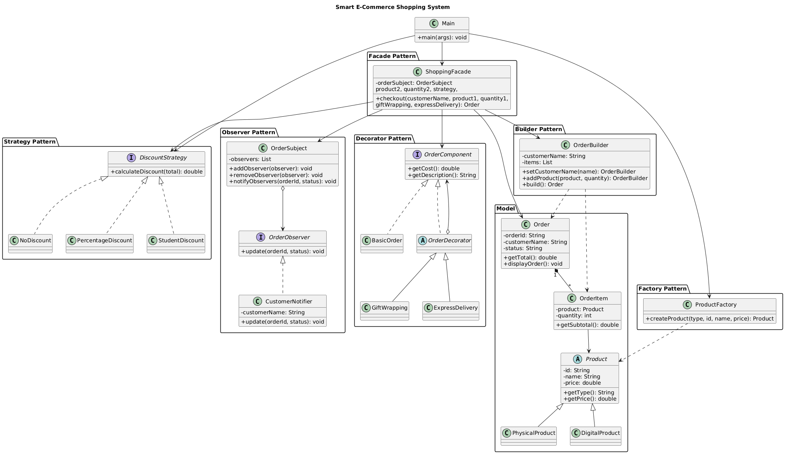
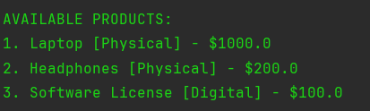
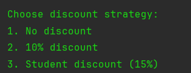
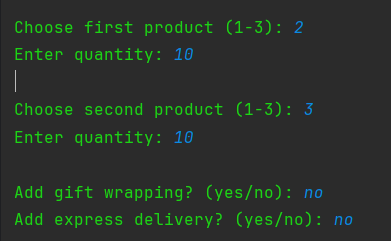
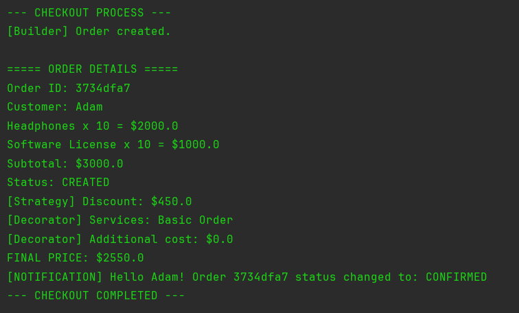

# Smart E-Commerce Shopping System

## Final Project Report

**Course:** Software Design Patterns  
**Language:** Java 17

**Team Members:**

* Student 1: Ibray Muratbek
* Student 2: Nikolay Kozlov

---

## 1. Introduction

The Smart E-Commerce Shopping System is a Java application that simulates an online shopping platform.

Customers can select products, create orders, apply discounts, add additional services, and receive order status notifications.

The main objective is to demonstrate the implementation of six software design patterns in one application.

## 2. Technologies Used

* Java 17
* IntelliJ IDEA
* Object-Oriented Programming
* PlantUML
* Git and GitHub

## 3. Design Patterns

### 3.1 Factory Pattern

**Class:** `ProductFactory`

Creates different product types, including physical and digital products.

### 3.2 Builder Pattern

**Class:** `OrderBuilder`

Constructs orders step by step by adding customer information and products.

### 3.3 Strategy Pattern

**Interface:** `DiscountStrategy`

Implements interchangeable discount algorithms:

* No Discount
* Percentage Discount
* Student Discount (15%)

### 3.4 Observer Pattern

**Classes:** `OrderSubject`, `CustomerNotifier`

Notifies customers when their order status changes.

### 3.5 Decorator Pattern

**Classes:** `GiftWrapping`, `ExpressDelivery`

Adds optional services and additional costs to orders dynamically.

### 3.6 Facade Pattern

**Class:** `ShoppingFacade`

Combines the checkout operations into one simplified interface.

## 4. System Architecture

The application is divided into several packages:

* `model` — product and order entities.
* `factory` — product creation.
* `builder` — order construction.
* `strategy` — discount calculation.
* `observer` — customer notifications.
* `decorator` — additional order services.
* `facade` — checkout coordination.

The `Main` class provides the application's entry point and user interaction.

## 5. UML Class Diagram

The UML diagram illustrates the system architecture, classes, interfaces, and relationships between the six design patterns.

### Class Diagram

## 6. Application Demonstration

The application demonstrates the complete shopping process:

1. Create available products.
2. Enter customer information.
3. Select products and quantities.
4. Choose a discount strategy.
5. Add optional services.
6. Calculate the final price.
7. Confirm the order.
8. Send a customer notification.

### Screenshots

**Figure 1. Product Selection**

**Figure 2. Discount Selection**

**Figure 3. Order Processing**

**Figure 4. Final Checkout and Notification**

## 7. Example Calculation

| Description            |    Amount |
| ---------------------- | --------: |
| Laptop                 |     $1000 |
| Headphones × 2         |      $400 |
| Subtotal               |     $1400 |
| Student Discount (15%) |     -$210 |
| Gift Wrapping          |       +$5 |
| Express Delivery       |      +$10 |
| **Final Price**        | **$1205** |

Order status: **CONFIRMED**

## 8. Testing

The following scenarios should be verified:

* Product creation using Factory.
* Order construction using Builder.
* Different discount calculations using Strategy.
* Customer notifications using Observer.
* Additional services using Decorator.
* Complete checkout using Facade.

## 9. Conclusion

The Smart E-Commerce Shopping System demonstrates the practical integration of six software design patterns in a Java application.

Each pattern addresses a specific software design problem and contributes to a modular and maintainable architecture.

The project provides practical experience with object-oriented programming, software architecture, and design pattern implementation.

## 10. References

1. Gamma, E. et al. *Design Patterns: Elements of Reusable Object-Oriented Software.*
2. https://refactoring.guru/design-patterns
3. https://docs.oracle.com/en/java/
4. https://plantuml.com/

---

**Astana IT University**
**Final Project — Design Patterns Course**
